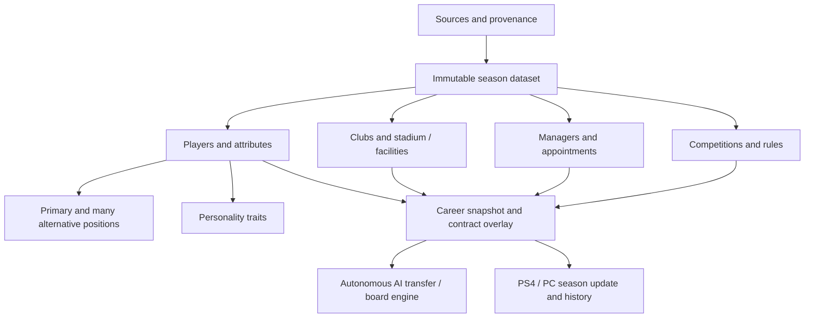

# PES Clubs Challenge — Football Data Warehouse Architecture v1

**Status:** proposed schema and contract, not installed on Render and not populated.  
**Owner:** development project. **Target game:** PES 2020 on PS4 or PC, retaining Fixed Cursor multiplayer rules.  
**Companion:** [Field-by-field data dictionary](DATA_DICTIONARY_V1.md) and [SQLite DDL](../../warehouse/schema_v1.sql).

## Outcome

Maintain a consistent, historically versioned football world in which AI clubs, players, managers, boards and competitions act autonomously. The same engine should work with the 2026/27 baseline, past seasons, or later overseas leagues. No managerial in-game manual data entry is required. All decisions are driven by a frozen data snapshot plus career events, with unknown or modelled attributes clearly labelled.

## Current inventory — verified in GitHub code, not live database row counts

| Domain | Existing code / authority | Coverage and gaps |
|---|---|---|
| Identities and registrations | `world_players`, `world_clubs`, `world_competitions`, `world_dataset_entries`, `world_dataset_rosters`, `world_player_source_refs` | 2026/27 source seed has 92 English clubs, 2,498 FC27 reference player rows. Identity reconciliation and roster membership remain provisional until validated. |
| Football attributes | `world_dataset_ratings` and `world_player_attributes` | FC27 source contains OVR and six aggregates (pace, shooting, passing, dribbling, defending, physicality), age/birth date, and *primary* position. Does NOT supply all individual PES 2020 attributes or comprehensive alternative roles. |
| Positions | `world_players.primary_position`, experimental `world_player_alternative_positions` on public QA branch | New canonical versioned `wh_player_positions` accommodates one primary and any number of alternative positions, each with optional suitability. Separate review table distinguishes "researched, no alternatives" from "unknown." |
| Contracts | `world_dataset_player_contracts`, `world_dataset_contract_snapshots`, `world_career_management_contracts` | Structures exist, reliable current player wages/expiry/renewal intentions are generally **not source-populated**. Multiple current import pathways must be reconciled rather than treated as three independent truths. |
| Finances | `world_dataset_club_finances`, `world_career_club_ledger` | Basic source/assumption status and scenario budgets exist. This is not evidence of real club cash, transfer budgets, wage bills, debt or ownership finances. |
| Institutional reputation | `world_pyramid_club_appeal`, `world_reputation_v2`, career reputation/progression | Current sporting proxy largely reflects rated squad strength; separately sourced long-term stature remains missing. |
| Manager identity/behaviour | `world_dataset_manager_profiles` historical-import scaffold | Limited fields/optional import; no comprehensive manager roster or independently populated traits, past appointments, coaching styles. |
| Player decisions | `world_player_decisions`, `world_player_morale`, `world_career_selling` | Simulated intentions and contract situations currently fill significant gaps; their generated values are not verified player facts. |
| Competitions | `world_competitions`, `world_2026_27_clubs`, international competition catalogue | Four English leagues have source membership; six overseas leagues have definitions only. Competition-specific format, prize, squad-registration and qualification details are incomplete. |
| Stadiums/facilities | No authoritative source-populated warehouse | New warehouse venue/tenancy/facility definitions; nothing should be displayed as sourced until imported. |
| Career evolution | `world_career_saves`, offers, registrations, boards, money, season review and events | Already career-scoped. Do not overwrite these using reference-data imports. |
| PES mappings | `world_pes_player_map`, transfer/export rules | Mapping and actual PS4/PC update round-trip remain subject to game-specific validation. FC OVR is not a native PES rating. |

## Identity and time model

1. **Stable global identities.** Reuse `world_players.player_id`, `world_clubs.club_id` and `world_competitions.competition_id`; managers and stadiums get persistent `wh_` IDs. Never merge people because their names match.
2. **Immutable dataset snapshots.** Every historical or reference attribute is keyed by `world_datasets.dataset_id`, whose source date drives player age and season-specific club employment. No current contracts in a 2004/05 career.
3. **Career state overlay.** Each new career starts from the selected immutable dataset, then uses existing career-scoped registrations, contract changes, board decisions, financial ledger and event history. Later transfers do not mutate source rows.
4. **Normalise one-to-many dimensions.** Positions, traits, attributes, manager appointments and source identities are child rows; NEVER a single string with comma-separated alternatives.
5. **Sources and unknowns.** All new value tables require a `wh_sources` reference. `origin` identifies real source, model, operator or derived value. No row or a NULL optional attribute is genuinely unknown.
6. **Migrations.** The SQL file is a staged additive specification. Initialise existing `world_v2`/`world_explorer` parent tables first. Explicitly version migration and backfill adapters before applying anywhere persistent. The v1 schema is SQLite-compatible; PostgreSQL can be the future backing store, with constraints preserved.

## Entity graph

## Field ownership: do not build competing sources of truth

| Fact | Existing authority until migration | New warehouse role |
|---|---|---|
| Name / stable player ID | `world_players` | Reuse internal ID; never duplicate. |
| Dataset registration | `world_dataset_rosters` | Read-only source for initial club membership. |
| OVR + six FC27 aggregate ratings | `world_dataset_ratings` | Remain labelled FC27 edition; map detailed attributes separately. |
| Positions | Experimental `world_player_alternative_positions` and `world_players.primary_position` | Proposed `wh_player_positions` becomes unified, dataset-specific canonical list **after explicit migration**, not by simultaneous dual-write. |
| Contract and initial squad role | `world_dataset_player_contracts`, with alternative historical importer `world_dataset_contract_snapshots` | Reconcile into one permitted source record; track conflicts before career binding. |
| Starting club finance | `world_dataset_club_finances` | Retain figures and labelled origin; do not duplicate in `wh_club_profiles`. |
| Manager identities | Existing historical importer profiles per dataset | Map verified source manager IDs to `wh_managers` and appointments; avoid name-only joins. |
| Competition identity/season entry | `world_competitions`, `world_dataset_entries` | Add dataset-specific detailed rules and prize schedules only. |
| Transfers, attitudes, morale, league outcome | Individual `world_career_*` tables | Career-changing facts; never rewrite immutable warehouse. |

## Player model: specific meanings

**Primary position** is the primary football role at that dataset's reference date. **Alternative positions** may be zero, one, or many. Each distinct role has an optional `suitability_ovr`, which is NOT automatically equal to the player's aggregate ability. If alternatives have not been researched, position-review status is `unreviewed` or absent; verified-complete with no alternatives is an intentional single-position conclusion.

**Attributes** represent separately sourced or explicitly simulated 1–99 measures such as sprint speed, defensive awareness and stamina. FC27's six broad categories are *not* a substitute for detailed PES attributes. Attribute edition, scale and source must be retained.

**Personality** captures relatively durable qualities (ambition, loyalty, professionalism, temperament, adaptability, financial drive). These should shape transfer propensity in the simulator but are **never public factual claims about real individuals** unless independently verified and permitted. Missing personality is not "50/100 by default"; neutral simulation baselines, if chosen, must be recorded with a model version.

**Live circumstances** (morale, playing-time role, request to leave, renewal willingness, medical availability, contract) are changeable career state. They cannot be flattened into a permanent personality score.

## Club and manager model

Separate club long-term **institutional stature** from current squad standard. A title-challenging club may lose players without immediately becoming a lower-status club. Stadium occupancy, capacity and facilities are independently sourced from current budgets, debt and wage obligations. Manager reputation and philosophy belong to the manager identity: when they change clubs, their approach moves with them, while the club's board continues to have its own priorities.

## Provenance classifications

- `source`: observed in a named, permitted provider/export and version; not automatically guaranteed correct.
- `operator`: explicitly entered/confirmed research with named evidence; not a claim that the user configured gameplay.
- `model`: generated for fictional career simulation; must remain tagged and versioned. Not a reported real wage, contract or desire to leave.
- `derived`: reproducible calculation from recorded facts; preserve input versions and method in source catalogue.
- **Missing**: no verified/modelled record; never silently converted to a known zero or false.

`wh_field_evidence` supports conflicting observations and review trails when two providers disagree. Rights are recorded in `wh_sources.rights_basis`; `unresolved` data must not be assumed redistributable because it can be viewed online.

## Data refresh and promotion workflow

1. Ingest approved source snapshot into a staging dataset with source/rights metadata.
2. Validate identity mapping (IDs not fuzzy names), roster uniqueness, allowed attribute scales, source date, club/competition membership, alternative-position reviews, and financial consistency.
3. Publish a **data coverage report** (real values vs modelled vs missing, by league/club/position and the exact AI decisions that depend on them).
4. Investigate contradictory records instead of silently picking the more convenient one.
5. Freeze a `dataset_id` when adequate for a test; clone only relevant facts into a fresh disposable career. Never apply new warehouse rows to existing careers.
6. Compare market decision audits before/after data updates with deterministic seeds, and retain per-deal rationales.

## Suggested readiness gates — targets, not current achievements

| Gate | Acceptance for a high-confidence transfer QA |
|---|---|
| Club and player identities | 100% unique stable IDs for participating clubs and players; no unresolved ownership conflicts. |
| Source provenance | 100% values used in tests traceable to a source / operator research / versioned explicit simulator. |
| Playable positions | Every assessed player has a primary position; explicit review coverage reported; the AI never invents alternatives. |
| Club squad depth | Snapshot league/club distribution checked for missing players and known position gaps; simulated rotational options counted once. |
| Key market variables | Every simulated bid explains whether wage/contract/status/personality are sourced, missing or a specific model assumption. |
| Manager behaviour | Manager database coverage reported separately from the use of generic simulation policies. |
| Competition rules | All playable registration, transfer-window and promotion/relegation restrictions defined and validated per dataset. |
| Live isolation | Zero modifications to previous saves; source snapshots remain unchanged between simulations. |

The current 92-club/2,498-record source is only a **starting reference pool**, not certification that these gates are met.

## Scope and sequencing

**This deliverable:** relational schema and field dictionary, executable constraints and schema tests. **Not included:** bulk data acquisition, manager/stadium enrichment, rights clearance, actual imports, a hosted warehouse, migrations on Render, or game-file export.

**Next recommended work:** an automated coverage audit of the existing 92-club data, followed by a source-by-source population plan for the player model (detailed attributes, multiple alternatives, contracts and personality).

**Safety:** The original production repository, live challenge careers, and private development career databases are not modified. Work occurs on an isolated branch of the public testing repository. No real-world salary or player intention will be invented to satisfy a completeness target.
